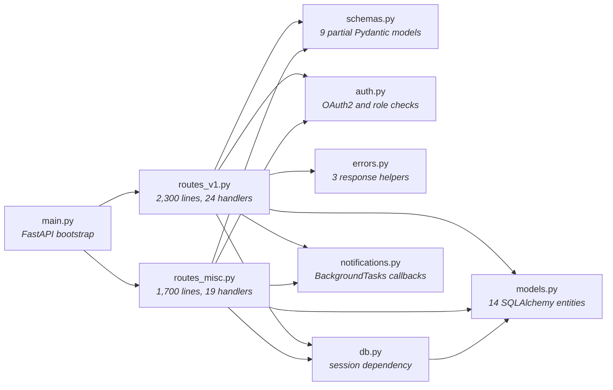
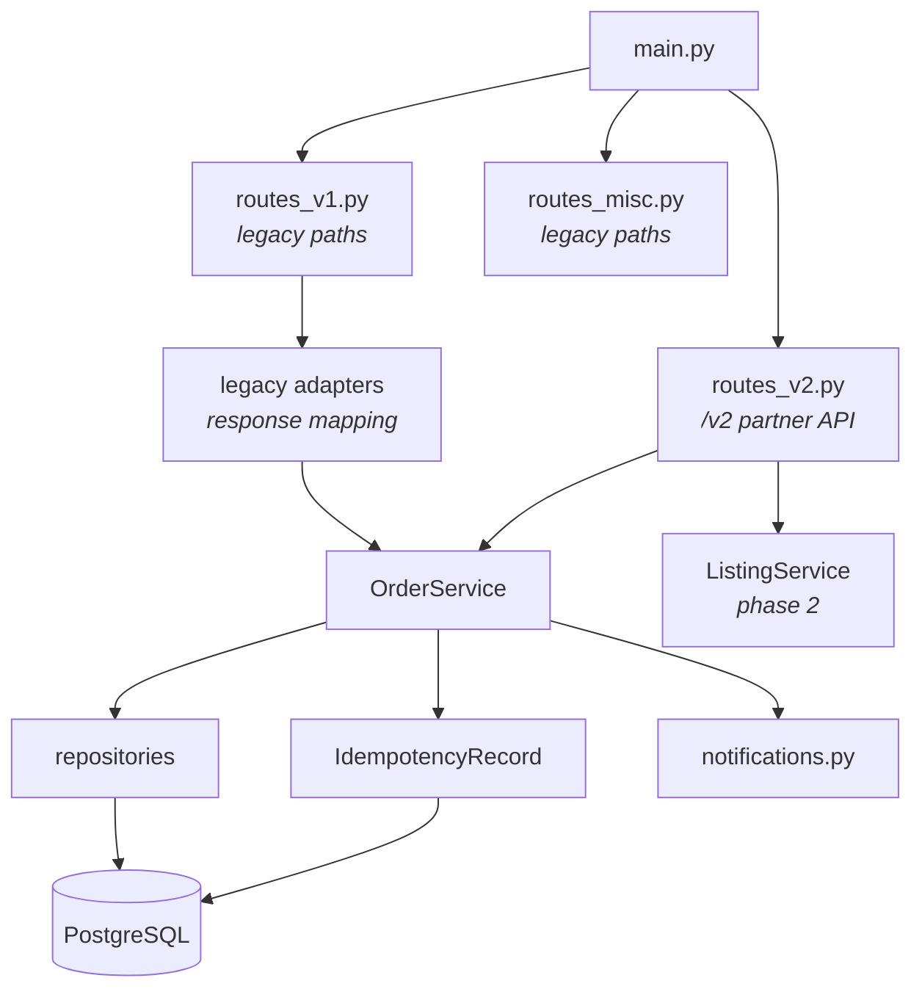

# Bookbay Versioned Api Core Design — Software Design Document

| | |
|---|---|
| **Status** | Current system (§1–5) + proposed target architecture and migration (§6–12) |
| **Last updated** | 2026-10-16 |

## 1. Introduction & Overview

Bookbay connects students who are selling used textbooks with buyers at nearby universities. Its mobile application and public API have grown for three years as one FastAPI deployment backed by PostgreSQL. A signed distribution partner now needs a stable API and generated client within one quarter. The current mobile release cannot be force-upgraded, and a long tail of installed versions will remain active for at least six months. Checkout correctness is commercially important because each listing normally represents one physical book and customer support must reverse any accidental second charge manually.

**Objective of this document:** describe the system as it runs today — its architecture, data, interfaces and components — and specify a migration-safe redesign. Bookbay’s FastAPI monolith exposes inconsistent contracts and can create two orders when mobile retries a timed-out checkout, putting partner integration and customer trust at risk. The target design introduces a versioned REST surface for new clients, keeps legacy routes behavior-stable for six months, enforces transaction-scoped checkout idempotency, and separates router, schema, service, and persistence boundaries so contracts and business rules are testable without hand-built response dictionaries.

## 2. System Architecture

The main.py module constructs the FastAPI application and includes routers from routes_v1.py and routes_misc.py. The first route module contains 24 user and order handlers, while the second contains 19 listing, search, cancellation, and refund handlers. Both modules obtain SQLAlchemy sessions from db.py, query entities from models.py directly, perform business decisions inline, and manually construct many response dictionaries. The schemas.py module contains nine Pydantic models, but several listing and order handlers accept dictionaries or return ORM-derived dictionaries instead. The auth.py dependency decodes OAuth2 tokens and performs role checks inside individual handlers. The errors.py module provides three response helpers used by only part of routes_v1.py, while other handlers return their own error bodies or allow exceptions to escape. Both route modules also schedule callbacks from notifications.py after selected order operations.

> The architecture diagram below is the same system that is pre-drawn (locked) on the whiteboard for this task; this repository contains its implementation.

### 2.1 Architecture Diagram (current system)



| Component | Role |
|---|---|
| main.py | FastAPI bootstrap |
| routes_v1.py | 2,300 lines, 24 handlers |
| routes_misc.py | 1,700 lines, 19 handlers |
| schemas.py | 9 partial Pydantic models |
| auth.py | OAuth2 and role checks |
| errors.py | 3 response helpers |
| db.py | session dependency |
| models.py | 14 SQLAlchemy entities |
| notifications.py | BackgroundTasks callbacks |

### 2.2 Known Limitations (observed in production)

Clients receive different field names for the same listing depending on which route produced it, and generated partner models cannot represent all variants cleanly. Collection endpoints use three pagination styles with different defaults, limits, and end-of-list behavior. An audit of failed requests found status-200 error bodies, conventional 4xx responses, and uncaught 500 responses containing internal exception text. Mobile checkout requests occasionally cross the client’s three-second timeout even though the database operation completes shortly afterward. In two confirmed cases, the automatic retry committed another order for the same user, cart, and cart version within seconds. Contract changes are slow because route tests require a real database fixture and assertions often depend on hand-built response dictionaries.

**Concrete examples in this repository**

| Area | Legacy behavior |
|------|-----------------|
| Listing shape | `/listings/all` uses `seller_id` and nested `book`; `/listings/{id}` uses `listingId` and flat `bookId`; seller inventory uses `state` instead of `status`. |
| Pagination | Cursor on `/listings/all`, page/size on `/getUserOrders`, offset/limit on `/search`. |
| Errors | `errors.bad_request` JSON in some order paths; raw `HTTPException` elsewhere; HTTP 200 with `"error"` keys on several listing and cart paths. |
| Checkout | `POST /createOrder` commits a new `Order` on every call; no idempotency store; no uniqueness on `(user_id, cart_id, cart_version)`. |

## 3. Component Design

| Component | Implementation |
|---|---|
| main.py | `app/__init__.py`, `app/main.py` |
| db.py | `app/db.py` |
| models.py | `app/models.py` |
| schemas.py | `app/schemas.py` |
| auth.py | `app/auth.py` |
| errors.py | `app/errors.py` |
| notifications.py | `app/notifications.py` |
| routes_v1.py | `app/routes_v1.py` |
| routes_misc.py | `app/routes_misc.py` |

### 3.1 Proposed components (target)

| Component | Path | Role |
|-----------|------|------|
| Legacy routers | `routes_v1.py`, `routes_misc.py` | Frozen HTTP paths and response shapes for mobile; thin delegation only where safety fixes apply. |
| Compatibility adapter | `app/legacy/` | Maps legacy request/response DTOs ↔ internal service models. |
| V2 routers | `app/routes_v2.py` | Partner-facing `/v2/*` with Pydantic response models and problem+json errors. |
| V2 schemas | `app/schemas_v2.py` | Stable OpenAPI types (snake_case JSON, documented enums). |
| Services | `app/services/` | Business rules, transactions, idempotency orchestration. |
| Repositories | `app/repositories/` | SQLAlchemy persistence; swappable in unit tests. |
| Problems | `app/problems.py` | RFC 7807 helpers for v2 only. |
| Idempotency store | `IdempotencyRecord` entity | Replay stored checkout responses for seven days. |

## 4. Assumptions, Constraints & Scale

Bookbay serves about 180,000 daily active users and averages 1,500 requests per minute, which is approximately 2.16 million requests or 12 requests per active user each day. Back-to-school peaks reach 4,500 requests per minute, or 75 requests per second, with 60 read requests and 15 write requests per second at the peak mix. The platform receives roughly 9,000 order-creation attempts and commits about 8,600 orders per day. Under normal PostgreSQL health, the new API should keep read requests below 250 ms p95 and order creation below 700 ms p95 without waiting for notifications. The implementation must remain a single FastAPI deployable using Pydantic, SQLAlchemy, and PostgreSQL; introducing a new distributed data platform is outside the quarter’s budget. Order and refund records are retained for seven years, API logs for 30 days, and replayable idempotency responses for at least seven days. The partner contract must freeze within one quarter, while legacy behavior cannot be removed or broken during the six-month mobile compatibility window.

## 5. Glossary

- **Idempotency key** — A client-supplied token that lets the server recognize retries of the same unsafe operation and replay its result.
- **Problem details** — A standardized JSON error shape that separates stable machine-readable fields from human-readable explanation.
- **Cursor pagination** — Pagination that resumes after an opaque position in a stable ordering instead of using a numeric row offset.
- **Repository interface** — An application-facing abstraction for loading and saving domain data without exposing ORM or storage details.
- **Compatibility adapter** — A boundary that translates a legacy request or response contract to a newer internal service without breaking existing clients.

---

## 6. Design goals and success criteria

| Goal | Success criterion |
|------|-------------------|
| Stable partner contracts | OpenAPI for `/v2` generated from Pydantic models; no ad hoc dict responses on v2. |
| Legacy compatibility | Existing paths (`/createOrder`, `/getUserOrders`, …) keep status codes and JSON keys for six months. |
| Checkout safety | At most one committed order per `(user_id, cart_id, cart_version)`; idempotency key replays identical responses for seven days. |
| Predictable collections (v2) | Single cursor pagination envelope on all v2 list endpoints. |
| Predictable errors (v2) | `application/problem+json` with stable `code`; no HTTP 200 error bodies on v2. |
| Testability | Service and idempotency logic covered by fast unit/integration tests without asserting hand-built legacy dicts in every test. |

## 7. Target architecture



**Dependency rule:** routers depend on services; services depend on repositories and domain types; repositories depend on SQLAlchemy models. Auth remains a FastAPI dependency injected at the router edge.

See also `docs/diagrams/proposed-architecture.excalidraw` for the whiteboard-style diagram.

## 8. API versioning and migration

### 8.1 Decision: URL prefix for v2

**Choice:** mount partner routes under `/v2` (e.g. `POST /v2/orders`).

**Rationale:** explicit in logs, routing, and generated clients; avoids ambiguous `Accept-Version` handling in caches and CDNs.

**Rejected:** header-only versioning — harder for partners to discover and test; legacy mobile already uses unversioned RPC-style paths.

### 8.2 Legacy freeze (six months)

- **No** renaming fields, paths, or error shapes on `routes_v1` / `routes_misc`.
- **Allowed:** delegate handler bodies to shared services when the external contract is unchanged.
- **Allowed:** safety fix on `POST /createOrder` — return the same legacy JSON for an duplicate checkout attempt instead of creating a second order (see §9). Mobile still receives `orderId`, `cartId`, `cartVersion`, etc.; only the duplicate case changes from “second order” to “first order replay”.

### 8.3 Partner rollout

Partners integrate only `/v2` during the quarter. Legacy routes are not documented in the partner OpenAPI bundle (separate tag or filtered schema export).

## 9. Checkout, actions, and idempotency

### 9.1 Action modeling

| Surface | Action | Notes |
|---------|--------|-------|
| Legacy | `POST /createOrder` | RPC name retained; body uses camelCase aliases (`cartId`, `addressId`). |
| V2 | `POST /v2/orders` | Resource-oriented create; body uses snake_case; returns `201` with `OrderResource`. |

Both map to **`OrderService.create_from_cart`**, a single transactional use case.

### 9.2 Idempotency (required for v2, optional header for legacy)

1. Client sends **`Idempotency-Key`** (UUID recommended), scoped per authenticated user.
2. Server computes **`request_hash`** from normalized `(cart_id, address_id)` (and user id).
3. **Same key + same hash:** replay stored HTTP status and body; **do not** enqueue duplicate notifications.
4. **Same key + different hash:** respond **`409`** with problem type `idempotency_key_mismatch` (v2) or legacy `errors.bad_request("idempotency_conflict", …)` if we add header support on legacy.
5. **No key (legacy mobile today):** rely on database **`UNIQUE (user_id, cart_id, cart_version)`** on `orders`. Concurrent duplicate commits resolve to loading the existing order and returning the legacy response shape — fixing timeout retries without an app update.

### 9.3 Transaction scope

All of the following occur in **one database transaction**:

- Idempotency record insert (or lock/read for replay)
- Order + order items insert
- Listing quantity decrements
- Idempotency record update with serialized response

Notifications run **after** commit via `BackgroundTasks`, only when a **new** order row is created.

### 9.4 Sequence: mobile timeout + retry

```mermaid
sequenceDiagram
    participant App as Mobile app
    participant API as FastAPI
    participant Svc as OrderService
    participant DB as PostgreSQL

    App->>API: POST /createOrder (no key)
    API->>Svc: create_from_cart
    Svc->>DB: BEGIN; insert order
    DB-->>Svc: commit OK
    Note over App,API: Client times out before response
    App->>API: POST /createOrder (retry)
    API->>Svc: create_from_cart
    Svc->>DB: UNIQUE violation on cart snapshot
    Svc->>DB: SELECT existing order
    Svc-->>API: legacy JSON (same orderId)
    API-->>App: 200 + first order payload
```

### 9.5 Retention

`IdempotencyRecord.expires_at = created_at + 7 days`. A nightly job deletes expired rows (implementation deferred; index on `expires_at` for cheap purge).

## 10. V2 collections and errors

### 10.1 Collection envelope (all v2 lists)

```json
{
  "data": [ "... resource objects ..." ],
  "pagination": {
    "limit": 20,
    "next_cursor": "opaque-or-null",
    "has_more": true
  }
}
```

- Default **`limit`:** 20; max **100**.
- Sort key documented per resource (e.g. listings by `(created_at desc, id desc)`).
- **No** offset pagination on v2 (avoids drift under concurrent writes).

### 10.2 Problem details (v2 errors)

Content-Type: `application/problem+json`

```json
{
  "type": "https://api.bookbay.example/problems/out-of-stock",
  "title": "Listing unavailable",
  "status": 400,
  "code": "out_of_stock",
  "detail": "Listing abc123 is no longer available",
  "instance": "/v2/orders"
}
```

Legacy routes **keep** existing error shapes (including HTTP 200 errors) — adapters do not “fix” them retroactively.

### 10.3 Listing resource (v2 canonical shape)

One representation everywhere on v2:

```json
{
  "id": "...",
  "seller_id": "...",
  "book_id": "...",
  "title": "...",
  "author": "...",
  "price": "12.50",
  "condition": "good",
  "status": "active",
  "quantity_available": 1
}
```

Legacy list/detail/search endpoints continue to emit their historical variants via adapters until deprecation.

## 11. Testing strategy

| Layer | What to test | How |
|-------|----------------|-----|
| OrderService | Idempotency replay, key mismatch, cart snapshot dedupe, stock validation | SQLite or Postgres test DB; no HTTP |
| V2 routes | Problem+json status codes, response schema validation | `httpx` + FastAPI `TestClient` |
| Legacy adapter | Golden JSON for `POST /createOrder` success path | Snapshot or explicit key assertions |
| Regression | No second order on double POST | Integration test in `tests/test_checkout_idempotency.py` |

Tests use `DATABASE_URL=sqlite:///` for CI-friendly runs; production remains PostgreSQL.

## 12. Trade-offs and alternatives

| Topic | Decision | Alternative considered | Why rejected |
|-------|----------|------------------------|--------------|
| Versioning | `/v2` prefix | Header versioning | Poor visibility in ops and SDKs |
| Duplicate checkout without app change | DB unique on cart snapshot | Require idempotency key on legacy | Mobile cannot ship key in six-month window |
| Idempotency storage | Postgres table in same DB | Redis | Budget constraint; transactional consistency simpler in one DB |
| Service layer | Module per domain | Full DDD aggregates | Quarter timeline; pragmatic extraction from routes |
| Legacy error normalization | Freeze legacy | Fix all 200-errors | Would break mobile parsers |
| Notifications | Still BackgroundTasks | Outbox + worker | Acceptable latency; scope control |

## 13. Phased delivery (one quarter)

| Phase | Deliverable | Risk reduced |
|-------|-------------|--------------|
| **1 (weeks 1–2)** | `OrderService`, idempotency record, cart-snapshot unique index, legacy `createOrder` delegation, tests | Duplicate orders |
| **2 (weeks 3–5)** | `/v2/orders`, `/v2/listings` read paths, problem+json, cursor lists | Partner contract |
| **3 (weeks 6–8)** | ListingService + misc v2 writes; OpenAPI export; observability dashboards | Full partner parity |
| **4 (weeks 9–12)** | Documentation freeze; adapter coverage audit; deprecations scheduled post month 6 | Integration confidence |

**Repository implementation note:** Phase 1 pieces live under `app/services/`, `app/repositories/`, `app/routes_v2.py`, and `tests/` in this fork for local verification.

## 14. Decisions log

| Date | Decision |
|------|----------|
| 2026-10-16 | Adopt `/v2` URL versioning for partners; legacy unversioned routes frozen. |
| 2026-10-16 | Checkout dedupe via `(user_id, cart_id, cart_version)` unique constraint plus optional `Idempotency-Key` store. |
| 2026-10-16 | V2 errors use RFC 7807; legacy errors unchanged. |
| 2026-10-16 | Single FastAPI deployable; no new infrastructure in quarter. |
